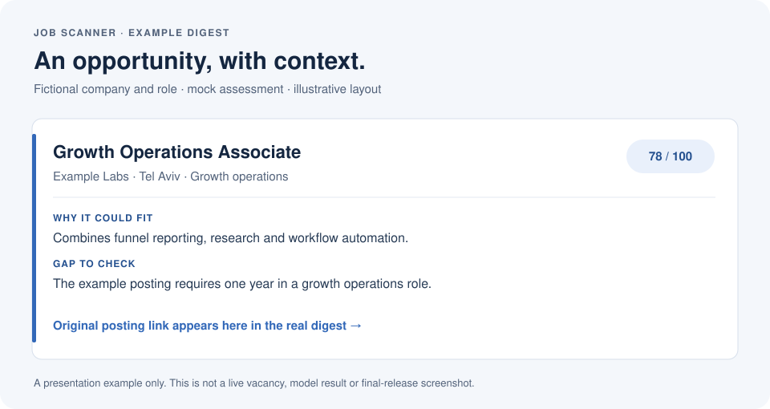
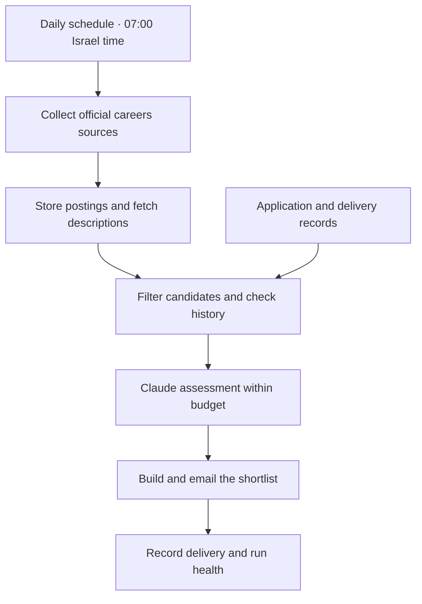

# Job Scanner

**A personal job-search automation that checks employer careers sources and turns new postings into a daily email shortlist, with reasons to consider each role and gaps to check.**

I built this for my own search for early-career business, growth and analytical roles in Israeli tech. I wanted a repeatable way to find opportunities, assess their requirements and keep track of what I had already seen or applied to.

**My role:** product requirements, matching criteria, source priorities and feedback on the recommendations. Claude implements the code; Codex provides a separate technical review. I direct the work and make the scope and release decisions.

> **Status — 12 October 2026:** the automation is in daily use. A filtering and reliability update is in progress; its final release has not yet been independently verified. The code in this public repository is the **September reference implementation**, while the October pilot described below has evolved beyond it. [Current status and evidence →](docs/current-status.md)

## A real run

The scheduled run on **12 October 2026 at 07:00 Israel time** produced:

| Sources read completely | Jobs assessed by Claude | Cards in the digest | Model cost |
|---:|---:|---:|---:|
| 398 | 86 | 15 | $0.65 |

The email was sent successfully. One recommendation, **Grain — AI Builder**, was relevant to my search. The run was still marked **partial** because 23 postings had no usable descriptions; their sources were held out of the digest. These are observations from one run, not average performance or a measure of matching accuracy. [What the numbers mean →](docs/current-status.md#verified-run-12-october-2026)

## What arrives in the inbox

The digest brings together the role, location, assessment, reasons for the match, gaps and a link to the original posting.

*Illustrative layout using fictional data and a mock assessment. The card explains the product; it is not evidence of model quality or the final release's format.*

## How the working pilot fits together

**Stack:** n8n for orchestration · JavaScript for workflow logic · Python for the public workflow generator · Google Sheets for operational records · Claude API for assessment · Gmail for delivery.

The public reference integrates Greenhouse, Lever, Ashby, Comeet and Workday. The newer pilot separates collection, description retrieval and matching so those stages can be checked independently.

## Decisions behind the project

- **Use official hiring sources.** Monitor a maintained set of employer boards and careers pages. Coverage depends on the sources connected and their readers; it is not a complete view of the job market.
- **Control the cost of assessment.** Filter candidates before model calls. The October pilot has a $2 daily model budget; n8n and other service costs are separate.
- **Keep collection separate from recommendation.** A source can be collected while its jobs remain withheld from the digest until it is ready.
- **Track applications and delivery.** Use those records to avoid unnecessary repeat recommendations and reflect application status. The latest review checked fixes to duplicate identity and conflicting application rows.
- **Check exclusions as well as recommendations.** A plausible email can hide jobs that were incorrectly removed earlier. Review now includes targeted counterexamples and replaying stored descriptions through the filtering steps.

## What is still being finished

The next release improves how the system reads experience requirements, handles uncertain evidence and reports incomplete runs. It also introduces revised digest sections and staged source releases. Five review findings are being addressed before final acceptance; [the status page](docs/current-status.md) records them.

The project is useful in my daily search. Source coverage is incomplete, and model assessments still need human judgment.

## Explore the implementation

| Start here | What you can inspect |
|---|---|
| [Status and evidence](docs/current-status.md) | Verified results, limitations and the boundary between the public code and the live pilot |
| [Run the reference locally](docs/reference-setup.md) | Offline fixture test and setup notes for the September implementation |
| [ATS integration notes](docs/ats-feeds.md) | Notes from working with the five original platforms |
| [Workflow generator](src/build_workflow.py) | Python that assembles the reference workflow and its JavaScript nodes |
| [Fixture harness](src/test_harness.js) | Offline checks against the committed workflow |
| [Example scoring prompt](scoring_prompt.example.md) | The earlier rubric, with personal sections left for configuration |

Built with AI assistance throughout implementation, testing and documentation. Licensed under [MIT](LICENSE).
