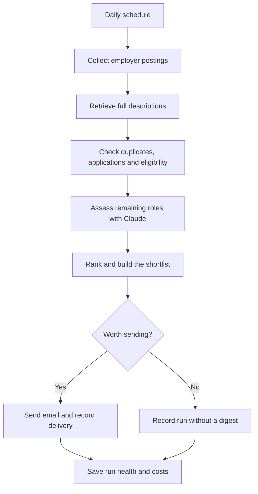

# Job Scanner

I built a job scanner for my own search for entry-level roles in Israeli tech, with a focus on sales at cybersecurity companies.

It checks employer careers sources, reads the job descriptions and sends me a shortlist with the fit, the gaps and the original link. The daily run starts at 07:00 Israel time.

It handles the refreshing. I still have to pass the interview.

**Live as of 1 November 2026:** 427 active sources. The latest release is deployed and has completed a real run through email delivery. The code in this repo is the **September reference implementation**; the live system described here has since evolved. [Current status and evidence](docs/current-status.md).

## What it does

- **Reads employers directly.** Careers pages and hiring systems, including 135 sources classified as cybersecurity.
- **Checks requirements first.** “Junior” does not cancel out five years of experience further down the page. Eligibility filters run before model assessment.
- **Ranks for my search.** Cybersecurity, AI and selected growth companies for SDR/BDR. Operations and analytical roles stay in view too.
- **Tracks history.** Application and delivery records help distinguish new opportunities from roles already seen or in progress.
- **Explains the shortlist.** Each card includes the fit, the gaps and a link. Nothing worth showing means no digest.

## One real run

The release verification on **1 November 2026** produced:

| Sources read completely | Roles assessed by Claude | Detailed job cards sent | Model cost |
|---|---|---|---|
| 423 | 20 | 6 | $0.24 |

Of 78 selected postings, 58 were filtered out before a model call. The email also contained one brief role listing and two roles already in my application pipeline.

Four sources failed or returned incomplete data, so the run was marked partial. This is one run's result. It measures delivery and cost, not recommendation accuracy. Service subscriptions are separate.

## How it works

**Stack:** n8n, JavaScript, Google Sheets, Claude API and Gmail. Python generates the public reference workflow, which covers Greenhouse, Lever, Ashby, Comeet and Workday.

Collection, description retrieval and assessment run separately. Unready sources stay out of the digest. Failed fetches do not mark jobs closed. Model spending is capped at $2 per run.

## What I learned

Check what never reaches the email. A shortlist can look right even when a useful role was filtered out before scoring. The review now tests exclusions, uncertain company classifications and saved assessments as well as the email itself.

Coverage is still incomplete. Five sources remain held, and some companies need classification. The scanner helps me find roles. I decide whether to apply.

## My part

I define the search criteria and product behavior. I review recommendations and make scope and release decisions. Claude implements the code. Codex reviews it and checks live results. AI assistance is part of the implementation, testing and documentation.

## Explore the project

- [Current status](docs/current-status.md): deployment, verification and remaining gaps.
- [Reference setup](docs/reference-setup.md): run the public code and its fixture tests.
- [ATS notes](docs/ats-feeds.md): integration details for the five original platforms.
- [Scoring prompt](scoring_prompt.example.md): the earlier rubric with personal sections left for configuration.

[MIT](LICENSE).
